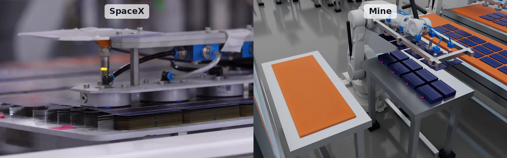

[](recordings/11-26-2026/starlink-side-by-side.mp4)

**[▶ Watch the comparison](recordings/11-26-2026/starlink-side-by-side.mp4)** · 6 seconds. SpaceX footage at original speed on the left; simulation at a constant 3.53× speed on the right.

# Starlink Manufacturing Project

An Isaac Sim reconstruction of solar-cell handling in Starlink factory footage. An ABB arm picks up, transfers, and releases a batch using simulated vacuum forces. The demonstrated motion is scripted; PPO training and checkpoint playback also work, but a reliable learned handling policy has not yet been demonstrated.

## File structure

| Location | Contents |
|---|---|
| `scripts/run_factory.py` | Entry point for the demo, manual controls, training, and policy playback. |
| `scripts/factory_demo.py` | Scripted waypoints and inverse kinematics. |
| `src/Satellite_Project/tasks/satellite_direct/config/Arm/` | Scene settings, actions, observations, rewards, resets, and PPO configuration. |
| `src/Satellite_Project/assets/data/` | Factory scene, robot model, fixtures, and cell batch. |
| `recordings/` | Videos, screenshots, and validation results. |
| [vision.md](vision.md#implemented-program-flow) | Source analysis and diagrams explaining startup, assets, and the training loop. |
| [log.md](log.md) | Development history and verification results. |

## Launch

Run from the repository root with Python 3.12, Isaac Sim 6.2, Isaac Lab 3.0, RSL-RL, SciPy, and ImageIO/FFmpeg. Replace `~/env_isaaclab/bin/python` with your environment's Python path if needed.

```bash
# Run the scripted pickup and delivery
~/env_isaaclab/bin/python scripts/run_factory.py --mode demo

# Open the full factory scene
~/env_isaaclab/bin/python scripts/preview.py

# Control the arm with sliders
~/env_isaaclab/bin/python scripts/run_factory.py --mode drive

# Train PPO, then run the saved policy
~/env_isaaclab/bin/python scripts/run_factory.py --mode train --num-envs 8 --iterations 500
~/env_isaaclab/bin/python scripts/run_factory.py --mode play --num-envs 8 \
  --checkpoint outputs/training/model_499.pt
```

Training writes to `outputs/training/`; checkpoints are generated locally and are not included in Git. The task controls one arm and treats eight cells as one rigid batch. Both arms are articulated in the [full factory scene](src/Satellite_Project/assets/data/environments/factory.usdc).

For another machine, update the local Isaac Lab paths in `pyproject.toml` before using uv. They currently point to `../../../../IsaacLab`.

[Original footage](https://www.youtube.com/watch?v=1dQK2CWAyxE&t=88s) · [ABB asset source and attribution](src/Satellite_Project/assets/data/robots/abb_irb1600/SOURCE.md) · [Full simulation video](recordings/11-26-2026/full-demo.mp4)
