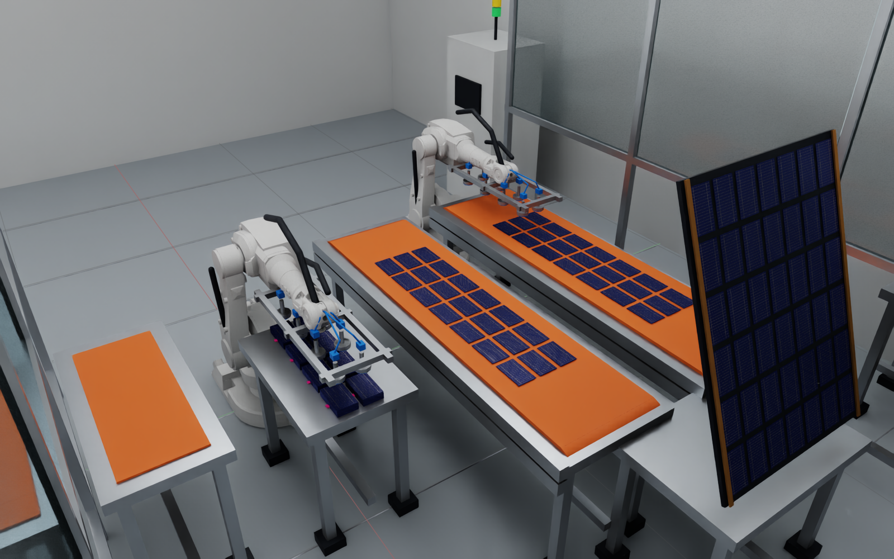

# Satellite Project — ABB photovoltaic handling cell

A saved OpenUSD factory scene and a working Isaac Lab batch-transfer task, reconstructed from
[vision.md](vision.md). Two articulated ABB arms, distributed tooling, solar-cell supply stacks,
orange transfer surfaces, transparent guards, an array section, controls, lights and four cameras
are composed in metre-scale, Z-up USD.

**Open in Isaac Sim:** [`factory.usdc`](src/Satellite_Project/assets/data/environments/factory.usdc),
a single-file scene with geometry and physics included. The editable composition is
[`factory.usda`](src/Satellite_Project/assets/data/environments/factory.usda); keep its adjacent
`robots/` and `environments/` folders together. Isaac Sim supplies the built-in `OmniPBR.mdl` material.



## Run

Run from this repository with the same installed Isaac Sim 6.2 / Isaac Lab 3.0 environment used
by S1-Project:

```bash
# Full saved factory; use its Overview, Pickup, Cells or Array cameras.
~/env_isaaclab/bin/python scripts/preview.py

# Interactive physical cell: six joint sliders, vacuum switch and reset button.
~/env_isaaclab/bin/python scripts/run_factory.py --mode drive

# Validated scripted approach → contact → lift → transfer → release → retract.
~/env_isaaclab/bin/python scripts/run_factory.py --mode demo

# Record live physics milestones without opening a desktop window.
~/env_isaaclab/bin/python scripts/run_factory.py --mode demo --capture \
  --visualizer kit --kit_args=--no-window

# Parallel PPO training; this task has seven actions and 31 state observations.
~/env_isaaclab/bin/python scripts/run_factory.py --mode train --num-envs 8 --iterations 500

# Reload the checkpoint produced by the completed training smoke run.
~/env_isaaclab/bin/python scripts/run_factory.py --mode play --num-envs 8 \
  --checkpoint outputs/training/model_11.pt
```

The supported Gym task is `SatelliteProject-Satellite-Arm-Direct`, in the existing
`src/Satellite_Project/tasks/satellite_direct/config/Arm/` layout. The manager-based and MARL
registrations inherited from the initial template remain unimplemented; they are not required
by these commands. AMP and distillation are also outside the implemented PPO workflow.

The interactive/task scene uses the same saved fixtures and robot. Its rear arm is a static
visual reference, and room walls are omitted for parallel environments. Both arms are articulated
in the full `factory.usda`. Joint targets can also be edited through Isaac Sim's articulation tools;
the vacuum logic runs in the task, rather than being embedded Python in the USD.

## What is verified

- Isaac Sim rendering of the full composed scene and inspection cameras.
- Physical joint motion and stable holding, collision support for the cell batch, contact-gated pickup,
  lift, transfer, release, and settled delivery checks.
- Parallel Isaac Lab simulation, PPO optimization, checkpoint creation and reload.
- Offline asset composition, six-joint structure, reachable waypoints, and unmodified upstream file hashes.

The short PPO run is an **execution test**, not a successful learned manipulation policy. The completed
handling demonstration uses inverse kinematics and joint drives. Training checkpoints and diagnostics
are under `outputs/`; dated screenshots and the progress history are in [log.md](log.md).

## Reconstruction limits

The robot is the real **ABB IRB1600 X-120 USD** from [Workr's robot library](https://github.com/work-r-labs/robots),
revision `ab6aa489855256de07ba46c7b45887fdbc42b607`. Its geometry closely resembles the supplied footage;
**the exact factory robot variant cannot be confirmed** from the available frames. It is not represented
as a verified exact copy. See [asset provenance](src/Satellite_Project/assets/data/robots/abb_irb1600/source.json)
and the included upstream [license](src/Satellite_Project/assets/data/robots/abb_irb1600/LICENSE).

Dimensions, placement, mass, tooling, drive tuning, vacuum behavior and trajectory are simulation
assumptions. Eight cells are represented as one rigid batch; the twelve-layer supply stacks are static.
Vacuum is a compliant, force-limited attachment with equal and opposite wrist reaction, a 4 mm approach
gate, and release/slip logic. Individual wafer flexure, fracture, leakage, conveyor transport and downstream
manufacturing processes are not simulated. The larger array section is separate from the transferred batch,
in accordance with the montage's uncertain continuity; its inspection stand is an inferred fixture.

## Rebuild and check

```bash
~/env_isaaclab/bin/python scripts/build_factory.py
~/env_isaaclab/bin/python scripts/preview.py --capture
~/env_isaaclab/bin/python scripts/validate_stage.py
~/env_isaaclab/bin/python scripts/run_factory.py --mode smoke --num-envs 8
PYTHONPATH=src ~/env_isaaclab/bin/python -m pytest -q
```

The builder changes project composition layers, never the pinned vendor USDs. `pyproject.toml` retains
the template's uv layout, with local Isaac Lab source paths corrected to `~/IsaacLab` from this checkout.
The commands above use the already installed environment; no new simulator installation is needed.
