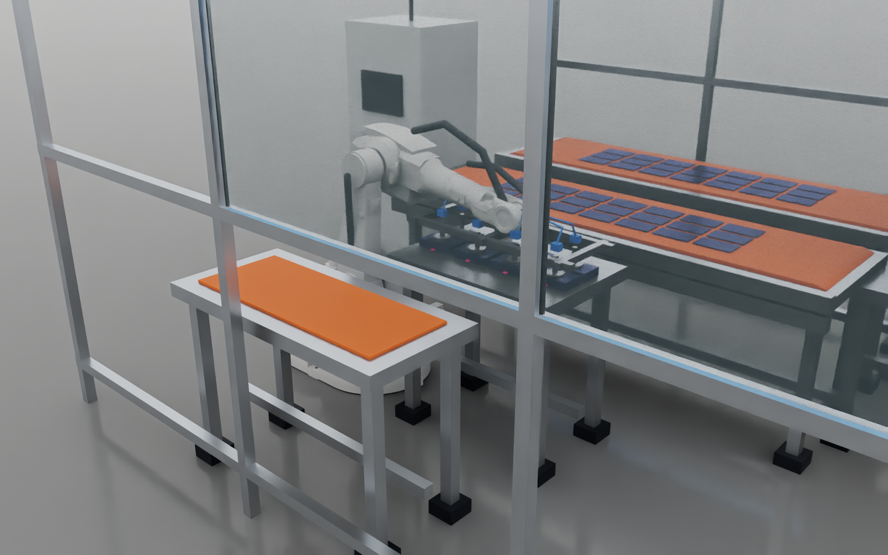
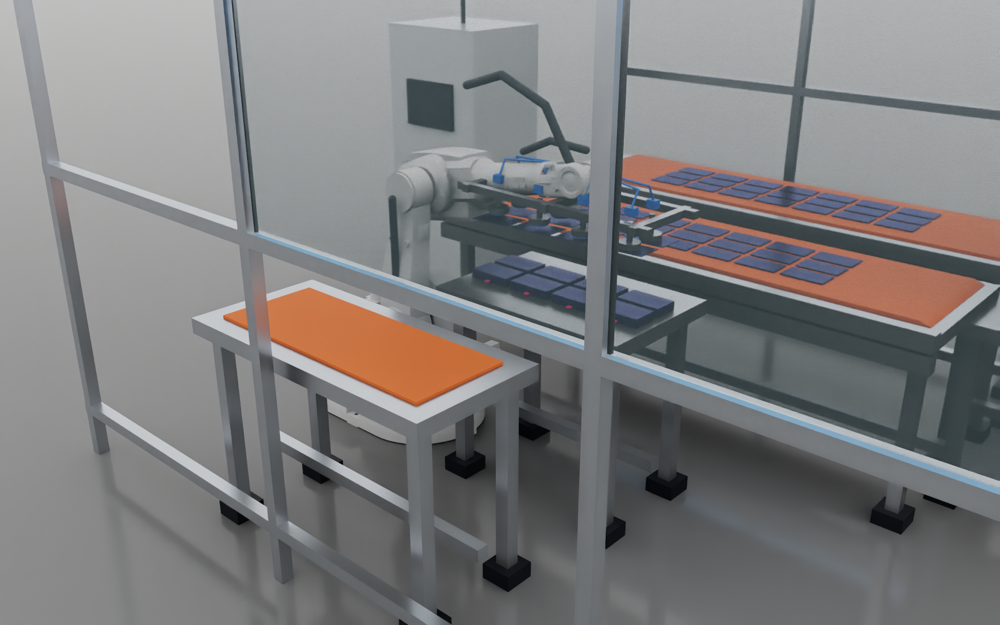
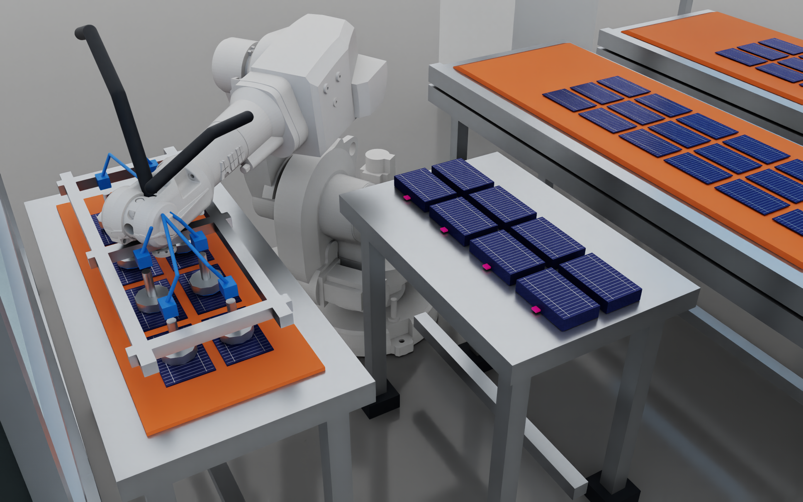
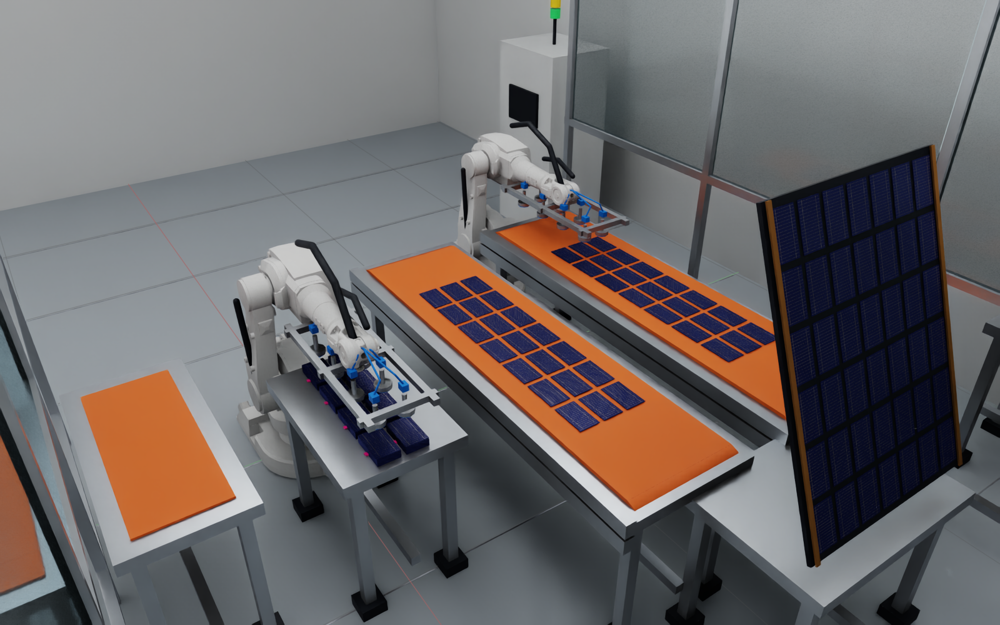
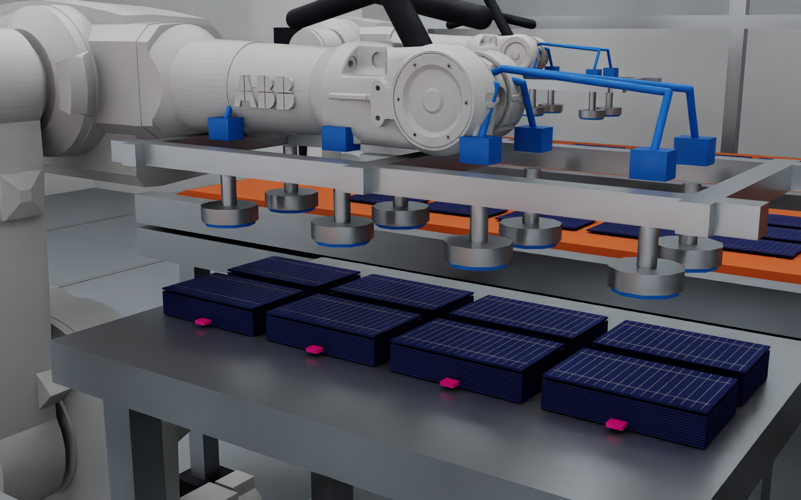
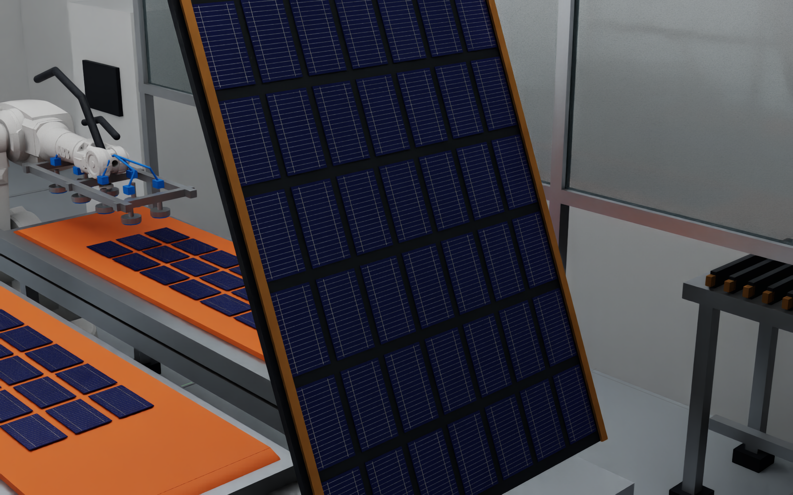

# Factory reconstruction log

All times use America/Vancouver. Milestones follow S1-Project's
`recordings/MM-DD-YYYY/h:mmam_description.png` convention; diagnostic captures go under
`recordings/misc/MM-DD-YYYY/`. Source footage remains in `assets/starlink-robot/`.

## 11-22-2026 — 11:13pm — Scope and source inspection

- Read `vision.md` and inspected the supplied factory stills; inspected S1 scene authoring and Mars/S1 recording conventions.
- Existing project is an Isaac Lab scaffold with no robot or factory USD and unimplemented environments.
- Scope: persist an offline-loadable composed USD with two articulated ABB arms, broad contact tooling, stacked cells, orange transfer surfaces, guard panels, larger array section, lighting, cameras and collision geometry. Add joint driving, a repeatable handling demonstration, and a trainable task using the existing package layout.
- Evidence boundary: the brief explicitly leaves robot model, dimensions, gripping physics and continuous process unknown. Model identification remains a visual hypothesis; geometry and process timings will be documented as reconstruction choices.
- Checked NVIDIA manipulator catalog and Workr's public USD library. Workr provides an IRB1600 X-120 whose flat upper-arm plate and circular wrist match the visible silhouette more closely than the IRB2600 product image. Exact variant cannot be established from these stills.
- Runtime available: `~/env_isaaclab/bin/python`, Isaac Sim and USD 26.08; RTX 5080. Will reuse this environment, as S1 does.

## 11-22-2026 11:21PM — Factory and first physics validation

- Built locally referenced factory, robot, batch and static training USD layers. Four authored cameras render in Isaac Sim.
- Corrected an initial supply-table overlap with the ABB shoulder housing; a six-axis drive smoke test now holds its commanded 0.145-radian base rotation with near-zero resting velocities.
- Converted project drive gains from radian units to USD angular-degree units and replaced the bare-flange inertia with an estimated tool-loaded inertia. Source robot USD files remain untouched.
- Added a 31-observation, 7-action Isaac Lab task: six joint increments and suction. Pickup is contact-gated; suction applies bounded forces and torques with opposite reactions to the wrist. Cell batch stays a dynamic rigid body.
- Initial rigid-joint attachment experiment failed; replaced with a compliant suction approximation. End-to-end transfer validation is still in progress.
- Initial exterior camera views were obstructed by guarding; moved inspection cameras inside the guard boundary.

### 11-22-2026 11:23PM — physics-contact

### 11-22-2026 11:23PM — physics-lift

### 11-22-2026 11:23PM — physics-transfer

### 11-22-2026 11:23PM — physics-release

### 11-22-2026 11:24PM — physics-contact

### 11-22-2026 11:24PM — physics-lift

### 11-22-2026 11:24PM — physics-transfer

### 11-22-2026 11:24PM — physics-release

## 11-22-2026 11:29PM — Delivery and final validation

- Delivered a 4 MB single-file `src/Satellite_Project/assets/data/environments/factory.usdc` and its editable `factory.usda` composition. Both were opened in Isaac Sim; all four final camera images were inspected.
- Independent native Isaac Sim test drove **both** ABB articulations to a 0.06-radian base target. Fixed bases stayed at their intended locations; the batch remained supported. Moved the rear control cabinet clear of the second arm after this test exposed an overlap.
- All **eight parallel environments** completed contact, lift, transfer, release and retraction. The released batch settled approximately 3.4 mm from the target center in the reported environment. Vacuum stayed off after release. Runtime evidence: `outputs/demo-parallel.log`.
- Manual UI tested for 30 steps, including a slider-model command to 0.1 radians and verification of the simulated joint response: `outputs/drive.log`.
- PPO completed 12 iterations on eight environments; checkpoint `outputs/training/model_11.pt` reloaded and ran for 360 steps. This is pipeline validation, **not** evidence of a learned successful policy.
- Final asset/registration/kinematics tests: **5 passed**. Source SHA-256 tests pass. All local Isaac Lab paths resolve. The one non-file dependency, `OmniPBR.mdl`, is bundled with Isaac Sim.
- Added README commands, source provenance and rebuild/validation scripts. Fixed the inherited test's overlong entry-point line for the repository lint check.
- Screenshot file writes now wait for the renderer's asynchronous writer before shutdown; all four final PNGs exist. Earlier exploratory captures are retained as progress evidence.
- Evidence caveat: supplied Figure 4's JPEG shows the later parallel-element machine, despite its array-section caption. The separate tilted section follows the written brief; the inspection stand, dimensions, eight-cell batch, static belts and physical tuning are reconstruction assumptions. The exact ABB model and real production cycle remain unverified.
- Machine-readable validation manifest: [validation.json](recordings/11-22-2026/validation.json).

### Final factory overview

### Final pickup station

### Final array-section view

