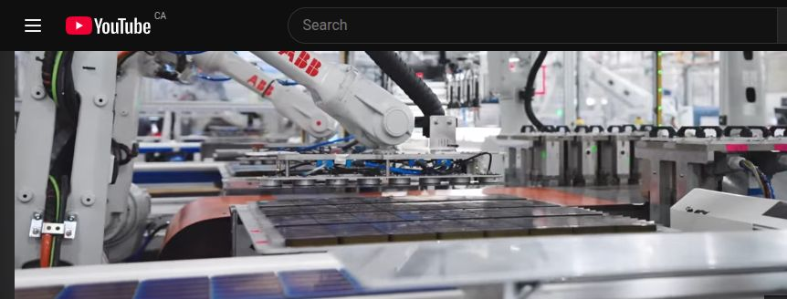
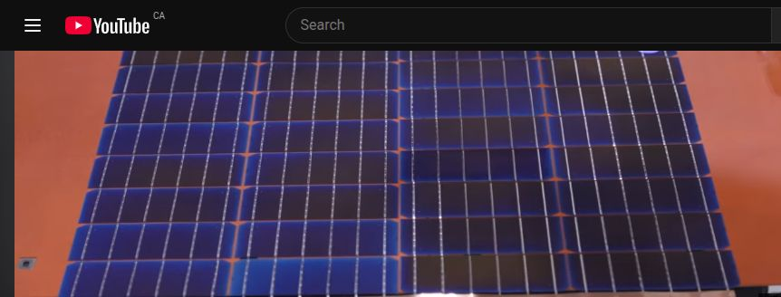
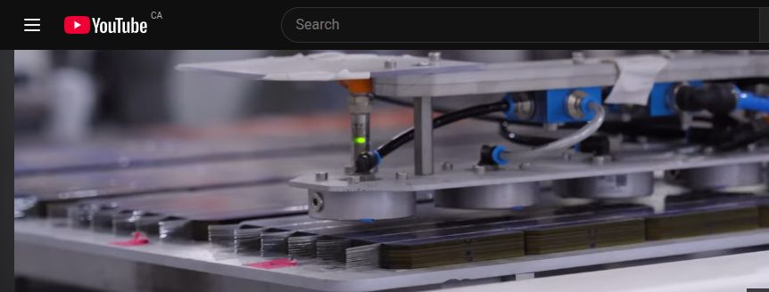
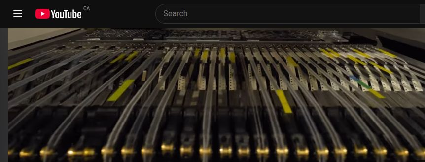

# Starlink factory: ABB robot and solar-cell handling, 1:28–1:34

## Source and inspection method

- **Video:** [SpaceX’s Satellite Factory — GeoXpedia](https://www.youtube.com/watch?v=1dQK2CWAyxE&t=88s).
- **Requested interval:** 00:01:28–00:01:34.
- **Additional reference:** The screenshot supplied by the user, showing white ABB robots above a tray of dark rectangular parts.
- **Method:** Opened the actual YouTube video, played briefly, paused, rewound, and used the player's frame-advance control to inspect successive frames and enlarged views through the requested interval. This description is based on those visual observations, not solely on the supplied screenshot or the video's description.
- **Timing precision:** The shot times below are approximate, based on the player's whole-second display. They are not frame-accurate edit boundaries.

## Identification: what is the robot handling?

The sequence depicts **solar-cell and solar-array-section handling**. The small, thin, dark blue-purple rectangles are identifiable as photovoltaic cells from the adjacent close-up: they have repeated parallel metallic conductor lines and are laid out in a regular grid. A later view shows a much larger rectangular section covered with those cells being tilted or transferred by robotic equipment.

The most defensible interpretation of the stack-handling shot is that a broad, multi-contact tool is picking a layer of solar cells from an organized supply tray. Multiple stacks remain on the tray beneath the tool. This looks like batch handling of thin cells rather than a gripper picking up a packaged computer processor. However, the exact number lifted, whether the lifted pieces are already electrically interconnected, and their precise product designation cannot be confirmed from the available views.

**A correction to the earlier description:** Saying the robot was definitely placing a connected strip onto a panel went beyond the evidence. The video confirms the solar-cell context, but it cuts between different viewpoints and handling operations. It does not provide an uninterrupted, unobstructed view of a single identifiable part traveling from its original stack to its final destination. The broad tool also hides the contact and release interfaces.

For a concise technical label, use: **“ABB robotic handling of photovoltaic cells and solar-array sections, using a broad multi-contact end effector.”** Vacuum gripping is strongly suggested by the tooling and tubing, but should remain an inference rather than a confirmed equipment specification.

## Screenshots and labeled features

These four screenshots were captured directly from the linked YouTube video within the requested interval. They are cropped to the player, with the displayed timestamp retained. Labels below each image identify positions in that image; the footage itself has not been regenerated or retouched. The pickup location is a visually supported interpretation, not a confirmed machine-process specification.

### Figure 1 — 1:28: gripping tool above the pickup tray

| Label | Where to look | What it identifies |
|---|---|---|
| **A — Gripping tool** | Upper center, directly below the white robot wrist | The wide silver framework with blue tubing and a row of circular contact modules underneath. This entire assembly is the end effector, not the part being manufactured. |
| **B — Likely pickup location** | Center, immediately below A | The shallow rectangular tray carrying closely arranged stacks of dark, thin cells. The robot approaches the upper surfaces of this material. |
| **C — Solar cells** | Lower foreground, above the player controls | The blue-purple rectangles with pale parallel lines. Figure 2 provides the clearer face-on view. |

**Reading the scene:** The large metal structure above the tray is the robot's handling tool. The thin dark pieces beneath it are the material being handled. The likely pickup is from the **top of the stacks in B**, not from the orange surface behind the tray.

### Figure 2 — 1:29: identifiable photovoltaic cells

- **A — Solar cells:** The blue-purple rectangular tiles covering most of the image. Their repeating outlines distinguish individual cells within the arrangement.
- **B — Metallic conductor lines:** The pale, parallel lines crossing the cell faces. These are the clearest visual clue that these are photovoltaic components.
- **C — Orange working surface:** Visible around the outer edges and through gaps. Its presence does not establish that it is the final backing of the flight hardware.

**What this frame establishes:** The “chip-looking” rectangles belong to solar-cell production. It does not establish whether the cells at the pickup station are already connected to one another.

### Figure 3 — 1:30: gripping head at the stack tops

| Label | Where to look | What it identifies |
|---|---|---|
| **A — Gripping tool** | Upper half and center-right | Silver plates, vertical supports, blue tubing, and the row of round silver modules along the bottom of the head. |
| **B — Pickup/contact interface** | Center-right, directly beneath the round modules | The boundary where the underside of the head meets the uppermost dark cell surfaces. This is the likely pickup interface. |
| **C — Stacked cell material** | Lower middle, above the tray edge | Multiple thin layers visible at the ends and sides of the dark stacks. These layers remain distinguishable beneath the tool. |
| **D — Supply tray** | Lower left through lower right | The pale rectangular fixture supporting the stacks, with bright pink markers near its front edge. |

**Where does it pick them up?** The best-supported answer is **from the uppermost layer of the stacks in C, at interface B**. This frame directly shows contact at that location. It does not reveal the exact number of cells gripped, prove vacuum operation, or show an unobstructed release at a destination.

### Figure 4 — 1:33: larger cell-covered section being handled

- **A — Larger cell-covered section:** The tilted rectangular assembly filling the right half of the frame, with a repeated grid of dark cells and pale conductor lines.
- **B — Edge bars or strips:** The copper-colored horizontal elements near the upper part of the section. Their exact electrical or mechanical role cannot be confirmed here.
- **C — Enclosure and machinery:** The silver-framed transparent guard at left and the blurred robot equipment behind the section.

**Continuity limit:** This later shot demonstrates handling of a larger section. It does not prove that the specific cells contacted in Figure 3 are the ones on this section, or that this is their immediate next manufacturing step.

## Scene overview

The setting is a brightly lit industrial automation cell. White articulated robot arms work among silver metal fixtures, flat transfer surfaces, orange belt-like surfaces, clear protective panels, and dense bundles of cables and tubing. The predominant colors are white and metallic gray for the machinery, dark blue to purple for the photovoltaic surfaces, orange for the transfer surfaces, and blue and black for hoses and service lines.

Several views are edited together rapidly. These include a wider view of the ABB arms, an oblique overhead view of arranged solar cells, a close-up of the supply stacks and gripping tool, a view looking along a large rectangular tool over an orange surface, and a wider robot movement followed by a close-up of a cell-covered section. Around the end of the interval, the edit changes to a different machine containing many closely spaced parallel elements.

No person is visibly handling the parts in these shots. The visible motion is mechanical: robot joints change pose, end effectors approach or withdraw from working surfaces, and a larger cell-covered section changes orientation. This is a manufacturing montage rather than an instructional recording of one complete machine cycle.

## Shot-by-shot description

### Approximately 1:28 — ABB arms above a supply tray

A large white ABB robot occupies the left and upper portions of the view. Its arm reaches diagonally toward the center of the workstation. The red ABB lettering is visible on the arm. A second white ABB arm appears behind it, indicating that the station contains more than one manipulator.

The foreground robot carries a wide, shallow rectangular metal end effector. Instead of a two-finger claw, the tool has a distributed set of circular contact modules beneath a framework of metal plates and spacers. Blue tubing, dark cables, and fittings run across its upper side. A thick black corrugated service conduit follows the robot toward the wrist.

Beneath the tool is a rectangular tray or fixture holding closely arranged dark, thin rectangular parts. The edges have a layered appearance, more clearly exposed in the later close-up. This is consistent with multiple stacks of cells arranged for repeated pickup. Their upper surfaces are dark and reflective, while their edges show lighter metallic or brownish highlights.

An orange belt-like surface passes behind the tray and curves downward at an end. Along the lower foreground, separate blue-purple rectangles are visible on another narrow work or transfer surface. Silver rails and machine framing partially obscure the lower part of the station. On the right are upright fixture elements, cable loops, and additional machine hardware.

The tool remains approximately parallel to the horizontal parts. The shot establishes the relationship between the arm, its broad gripping head, and the stacked material, but the tool blocks a clear view of exactly which parts are attached beneath it.

### Approximately 1:29 — close-up of a solar-cell grid

The edit cuts to an oblique overhead view of blue-purple photovoltaic rectangles arranged in rows and columns against an orange surface. Narrow gaps separate the rectangles. Their corners appear clipped or rounded in places, and their coloration changes between blue, violet, and almost black with the viewing angle and reflections.

Numerous straight, pale metallic lines run across the dark cell faces. The recurring pattern of reflective semiconductor surfaces and conductors is the strongest visual evidence identifying the parts as solar cells. Along the near edge is a broader copper-colored strip or rail. The view alone does not establish whether that strip is an electrical interconnect, a fixture feature, or another part of the handling arrangement.

The cells appear deliberately aligned rather than loosely scattered. This view shows their geometry and arrangement clearly, but it does not expose the underside, bonding material, wiring topology, or backing structure. The orange surface should therefore not automatically be described as the permanent substrate of the final satellite array.

### Approximately 1:29–1:30 — tool and stack close-ups

A close view emphasizes the robot's metal tool structure, blue tubing, black fittings, and small wiring. Some frames have motion blur and a shallow depth of field, limiting identification of individual fittings.

The next side-on view shows multiple stacks of very thin, dark rectangular pieces on a pale metal tray. The stacked edges are conspicuous: each supply position contains many layers, and the row of stack ends creates a repeated stepped outline across the foreground. Small bright pink markers or tabs are visible near the tray edge.

Above the stacks, a row of round, silver-colored contact modules is mounted beneath a long plate. Blue features are visible at some lower contact edges. The modules approach the uppermost dark surfaces, and one inspected frame shows them down against the top layer. Other frames show a clearance between the tooling and the stack tops.

This arrangement strongly suggests a tool designed to contact several thin parts across a distributed area. Vacuum pickup is a plausible explanation because the tool has multiple contact locations and fluid tubing, and because broad support is appropriate for fragile flat parts. The footage does not reveal a vacuum gauge, internal airflow, valve state, or a model label that would prove the exact gripping principle.

The stack geometry supports interpreting this as a supply/pickup station. It does not show the robot lifting the entire thickness of the stacks. The number of cells removed in one operation cannot be counted reliably because the tool conceals much of the upper layer.

### Approximately 1:31 — broad tool over an orange transfer surface

The viewpoint changes to look along a large rectangular handling tool. Its upper structure has repeated cross-members and open rectangular spaces. Black cables, blue hoses, small fittings, and a prominent corrugated conduit run along or above it. Horizontal dark cylindrical components project toward the sides.

The orange surface spans most of the workstation behind and beneath this tool. At the right edge it curves over a dark roller-like end, supporting the interpretation that this is a conveyor belt or another flexible transfer surface. A cell-covered portion is visible toward the left side of the station.

As the tool moves clear, a broad orange area is exposed. Crucially, the inspected view does not show a newly deposited grid plainly remaining in the central exposed area. It would be inaccurate to describe this frame as conclusive proof that the robot has just released cells onto that exact location. The operation could involve lifting or transferring a section; the contact area is hidden during the decisive part of the movement.

### Approximately 1:32 — wider view of robot movement

The edit changes to a wider angle through or alongside the machine's protective enclosure. A large white ABB robot stands near the center, with another white robot structure on the right and further tooling behind it. Clear panels in silver extrusion frames separate the viewer from the work area.

The central arm changes its pose around its large joints. Black service cables curve along the arm, and blue lines descend toward the lower machinery. A flat metallic fixture is visible at the right foreground. Orange transfer surfaces remain visible deeper in the cell. Small green and yellow indicator lights punctuate the otherwise white and gray equipment.

This view establishes that the station includes robot-driven repositioning of larger tooling or workpieces. It is not sufficiently unobstructed to trace an individual small cell from the earlier tray throughout the motion.

### Approximately 1:33–just before 1:34 — larger cell-covered section at an angle

A close-up shows a larger rectangular section populated with a grid of dark photovoltaic cells. Many parallel light-colored conductor lines cross the faces. The section is held at a steep angle rather than lying flat on a work surface, and its orientation changes during the shot.

A white robot and a loop of black cabling are visible behind it. Near an edge of the moving section, copper-colored bars or strips cross the view. These may belong to the workpiece or the handling fixture; their exact role is not established by the images.

This is visibly a larger cell-covered section, distinct in scale from the individual thin rectangles in the supply stacks. It should not be called a complete flight-ready solar array solely from this shot: its backing, deployment mechanism, final integration state, and inspection status are not shown.

### Around 1:34 — transition to another machine detail

At the end of the requested interval, the video cuts to a close-up of many closely spaced parallel machine elements. Dark elongated components, thin metallic strips or guides, and a row of gold-colored ends or contacts repeat across the image. A few yellow markers stand out among the darker hardware.

This view belongs to the next manufacturing detail in the montage. It cannot be identified confidently as a particular joining, testing, or feeding operation from the visible geometry alone. It should not be treated as proof of how the preceding robot attaches the cells.

## What the motion probably accomplishes

The likely production role is automated handling of solar cells and partially assembled solar-array material: retrieving thin parts from organized supply stacks, positioning or transferring them using a distributed gripping tool, and moving larger cell-covered sections between operations.

The broad end effector is important. Thin photovoltaic material benefits from support at several points, and a tool spanning multiple parts can handle them together. That is a general engineering explanation consistent with the visible hardware, not a verified statement about this station's programmed cycle, tolerances, or throughput.

The sequence does not visibly demonstrate cell fabrication, semiconductor processing, adhesive dispensing, soldering, welding, lamination, curing, or electrical testing. Those processes may occur elsewhere, but identifying any of them here would require additional evidence.

## Confidence and remaining limits

| Claim | Assessment | Evidence or limitation |
|---|---|---|
| The white arms are ABB robots | Confirmed visually | Red ABB markings are readable. |
| The dark blue-purple rectangles are photovoltaic cells | High confidence | Adjacent close-up shows characteristic cell faces, parallel conductors, and a repeated array layout. |
| The tray contains multiple stacks of thin parts | Confirmed visually | Layered edges and separate stack positions are visible. |
| The tool has distributed contact modules | Confirmed visually | Several circular modules are visible along the underside. |
| The tool uses vacuum gripping | Strong inference | Tool geometry and tubing support it; the operating principle is not explicitly labeled. |
| The stack operation picks a batch of top-layer cells | Likely interpretation | Contact with the stack tops is visible, but the lifted layer is partly hidden. |
| The robot deposits those same cells at a specific downstream location | Not established | Cuts interrupt continuity, and tooling obscures pickup/release interfaces. |
| The later shot moves a larger cell-covered section | High confidence | The grid-covered section is visibly tilted and repositioned. |
| The small cells are already electrically connected when picked | Not established | Interconnections cannot be resolved at the pickup interface. |
| Exact cell count, dimensions, chemistry, thickness, robot model, or cycle time | Not established | No reliable scale, identifying labels, or uninterrupted complete cycle. |

## Standalone scene description

Inside a bright automated manufacturing enclosure, white ABB robot arms work above silver trays and orange transfer surfaces. One arm carries a broad rectangular gripping head fitted with multiple round contact modules, blue tubing, and black service cables. Beneath it, thin dark photovoltaic cells sit in closely arranged stacks. The tool approaches the stack tops, with its wide face held parallel to the material. A cutaway reveals the cells laid out in a regular blue-purple grid, their surfaces crossed by fine metallic conductor lines. Further cuts show a long handling tool moving clear of an orange belt-like surface, a wider view of articulated robot motion behind transparent guarding, and a larger cell-covered section being tilted through the workstation. The sequence shows automated solar-cell and solar-array-section handling, but its rapid edits and obscured gripping interfaces do not reveal a complete, traceable pickup-to-placement cycle for one individual part.
